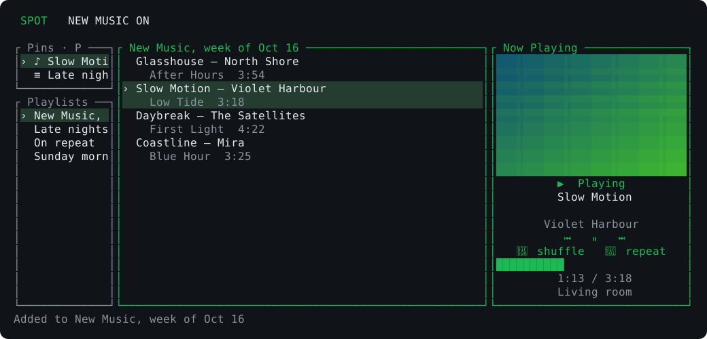

# Spot

A lightweight Rust Spotify remote, keyboard-driven terminal interface, and weekly music diary.



## Install

With a stable Rust toolchain installed, run this from the project directory:

```sh
cargo install --path . --locked
```

The executable is `spot`. It controls Spotify on your phone, computer, or speakers; audio playback happens on that device.

## Spotify setup

1. Create an app in the [Spotify Developer Dashboard](https://developer.spotify.com/dashboard), with Web API access.
2. Add the exact redirect URI `http://127.0.0.1:8888/callback` and save it.
3. Add your Spotify account to the app's user allowlist. The app owner needs active Premium; Development Mode supports up to five users for new apps.
4. Copy the client ID, then run:

```sh
spot login --client-id YOUR_CLIENT_ID
```

Open the printed URL in your browser and authorize the app. No client secret is needed. Login listens only on the loopback interface, validates OAuth state, and uses PKCE. Tokens refresh automatically. Open Spotify on a playback device before using playback commands.

```sh
spot devices
spot transfer "My Phone"
spot play
spot now
spot tui
```

`spot` without a subcommand opens the TUI. `spot --help` lists all commands.

## Commands

```sh
spot pause
spot next
spot prev
spot volume 50
spot search "Massive Attack"
spot search "Mezzanine" --kind album
spot search "Massive Attack" --kind artist --limit 100
spot search "Massive Attack" --offset 50
spot recent
spot playlists
spot playlists PLAYLIST_ID
spot playlist new "Evening music"
spot play spotify:track:TRACK_ID
spot play spotify:album:ALBUM_ID
spot queue TRACK_ID
spot add TRACK_ID PLAYLIST_ID
spot like                  # currently playing track
spot like TRACK_ID
spot newmusic on
spot add TRACK_ID           # this week's diary playlist
spot newmusic off
```

Replace the uppercase example IDs with Spotify's 22-character IDs. Track/playlist arguments also accept Spotify URIs and `https://open.spotify.com/...` share links. Quote links containing query parameters. CLI and TUI searches fetch up to 50 results automatically, using pages of ten. The CLI also supports `--limit 1..100` and `--offset` to choose how many results to fetch and where to start. Searches stop early when Spotify has no more results. Playlist lists and contents paginate automatically.

## Terminal interface

The left sidebar has **Pins** above **Playlists**. Select a song or playlist and press **Shift+P** to pin it; press the same key to unpin it. Pins are saved locally and survive restarts. Tab cycles through Pins, Playlists, and Tracks; Enter plays a pinned song or opens a pinned playlist. The middle panel shows tracks or search results. The **Now Playing** panel on the far right shows album art, a play/pause indicator, the active device, and interpolated progress, refreshed from Spotify every five seconds. Requests run in a background worker; errors appear in the footer.

| Key | Action |
| --- | --- |
| Space | Play/pause |
| n / p | Next/previous |
| s | Toggle shuffle |
| Shift+R | Cycle repeat mode (off / all / one) |
| Shift+P | Pin/unpin selected song or playlist |
| j / k or arrows | Move selection |
| Enter | Open playlist / play selected track |
| Tab | Switch panel |
| / | Search tracks |
| Ctrl+P | Fuzzy picker for playlists and currently loaded tracks |
| a | Choose a destination playlist, or add to this week's diary |
| m | Add the currently playing song to this week's New Music playlist |
| c | Create a new playlist |
| l | Like selected track (current track if no selection) |
| v | View the playing song's album |
| V | View the playing artist's songs (best-matching search results, up to 50) |
| d | Device picker |
| t | Choose a color theme |
| + / - | Volume |
| N | Toggle new music mode |
| r | Recently played |
| z | Listening mode (also enters automatically after 60 seconds idle) |
| x | Remove track from viewed playlist; type `yes` to confirm |
| w | Launch the local web player (see below) |
| ? | Help |
| Esc | Close popup |
| q / Ctrl+C | Quit |

Type to filter pickers; use arrows and Enter to select. Removing a track removes all occurrences of that URI from the playlist. Spotify permits editing only playlists you own or collaborate on. In current Development Mode, reading playlist contents is also limited to those playlists.

After 60 seconds without keyboard input, listening mode displays a centered title, artist, and live progress bar. Any key returns to your previous view; that first key only wakes the interface, so it won't skip a track, pause, or quit. Playback continues updating while this view is shown. Press `z` to enter it immediately.

## Local web player

By default `spot` is a *remote* — play/pause/next/etc. control whatever device is already active (phone, speaker, the official desktop app). Pressing `w` launches an actual playback device backed by Spotify's official [Web Playback SDK](https://developer.spotify.com/documentation/web-playback-sdk): a tiny loopback-only HTTP server (`127.0.0.1`, port 47823) serves a minimal page that registers a Connect device named **Spot**, opened in a chromeless Edge window. As soon as it connects, the page transfers playback to **Spot** on its own, and from then on every existing control in this app targets it like any other device — no separate playback path to learn.

If the Spot window says the browser blocked autoplay (usually because Edge was already running and ignored the launch flags), click its "enable audio" button to start playback. You can skip this step next time by doing the following:

1. In a regular Edge window, paste `edge://settings/content/mediaAutoplay` into the address bar (or go to **⋯ → Settings → Cookies and site permissions → Media autoplay**).
2. Under **Allow**, click **Add** and enter `http://127.0.0.1:47823`.

The server always uses that port (falling back to a random one only if it's taken) so the setting sticks. The Spot window shows these same steps when it gets blocked.

Requires Spotify **Premium** and the `streaming` OAuth scope, which was added after this feature shipped — run `spot login` again if your existing session predates it. If Edge isn't installed, open the printed `http://127.0.0.1:<port>` URL in any browser that supports Spotify's SDK (Chrome, Edge, or Firefox).

## Weekly music diary

New music mode routes additions without an explicit destination to a private playlist named `New Music, week of Oct 16`. Weeks start Thursday at **9 pm America/Los_Angeles** and use the following Friday's release date. Daylight saving time is handled by the timezone database. The date-to-playlist mapping includes the year. Newly created diary playlists include a dated description so they can be rediscovered if the local mapping is lost.

This feature records songs you choose. Spotify's Development Mode does not provide the new releases endpoint. Explicit playlist arguments always take precedence over diary routing.

Press `m` in the TUI to save the currently playing song directly to this week's playlist. This reads fresh playback state and works even when New Music mode is off; it doesn't change that setting. The `a` key continues to act on the selected song.

## Configuration

`spot config` prints the configuration directory. Copy settings from [config.example.toml](config.example.toml), or edit the file created after login. Theme colors and key-to-action mappings are configurable. `SPOT_CONFIG_DIR` overrides the directory; `SPOT_CLIENT_ID` supplies a client ID during login.

`tokens.json` contains credentials in plaintext in your OS user configuration directory. Unix writes use owner-only permissions; Windows uses the directory's inherited user permissions. Do not commit or share this file. Use a single running instance when changing config or diary mappings.

If a session is revoked, run `spot login` again. A rate-limit response reports Spotify's retry delay and suppresses requests until it expires; mutations are not automatically retried on network failures. If no device is active, open Spotify on a device and use `spot transfer`.

## Development and releases

```sh
cargo fmt --check
cargo clippy --locked --all-targets -- -D warnings
cargo test --locked
```

Tests use local mock HTTP servers and do not need Spotify credentials. CI runs these checks on Windows, macOS, and Linux. See [docs/releases.md](docs/releases.md) for cargo-dist publishing setup.

Regenerate the illustrative screenshot with `cargo run --example preview`. On machines with limited memory, add `-j 1` to Cargo build/test commands.

The optional album-art color effect, native terminal audio through spotifyd, and a web player are not included.

API compatibility follows Spotify's [2026 migration guide](https://developer.spotify.com/documentation/web-api/tutorials/february-2026-migration-guide): playlist `/items`, creation through `/me/playlists`, and saves through `/me/library`.
